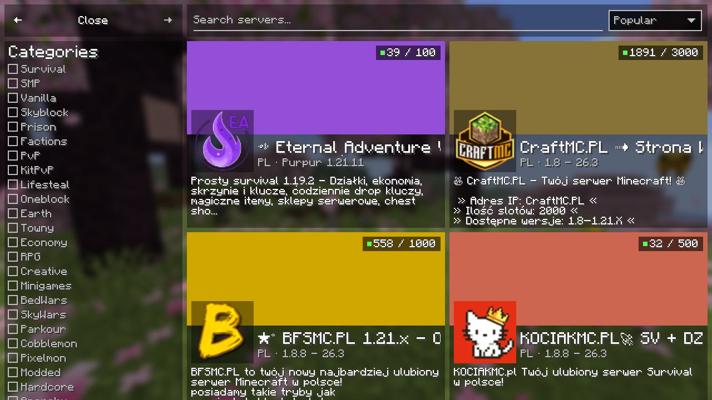
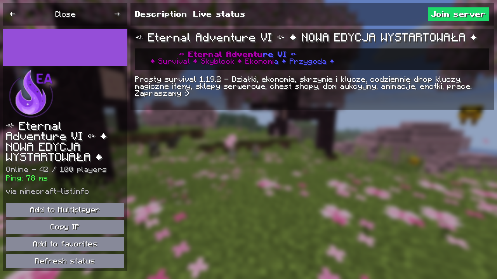
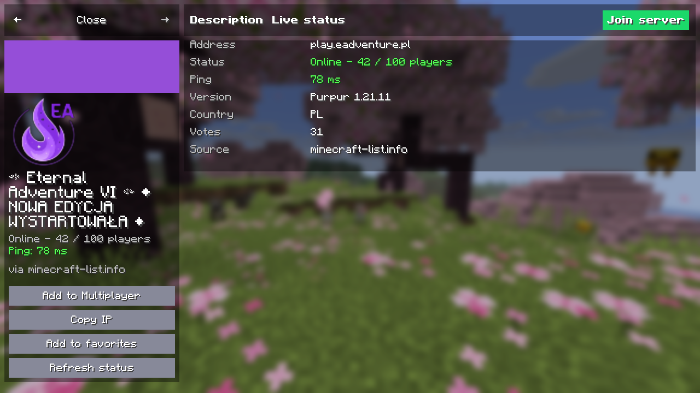
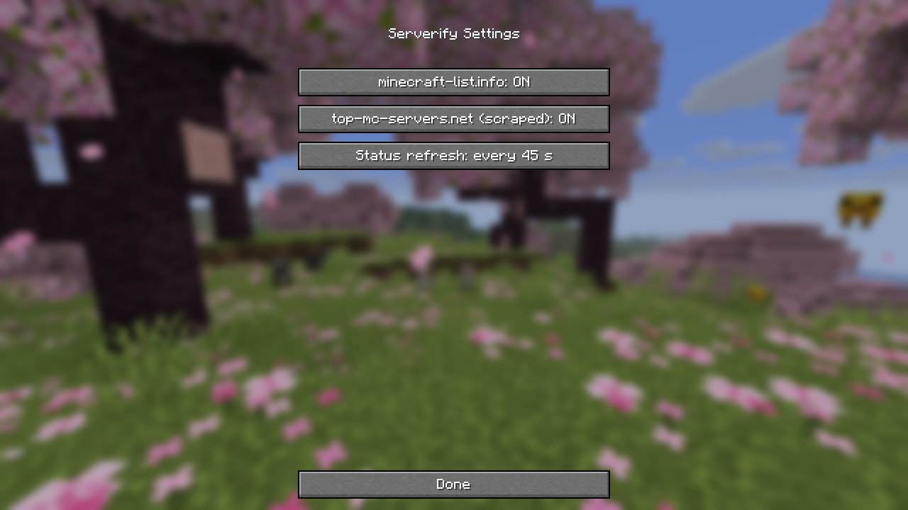

# Serverify

[](https://github.com/Louchatfroff/serverify/actions/workflows/build.yml)
[](https://github.com/Louchatfroff/serverify/releases/latest)
[](LICENSE)


A client-side mod for [Fabric](https://fabricmc.net), Quilt, [Forge](https://minecraftforge.net) and [NeoForge](https://neoforged.net) that adds a fast, native **server browser** to Minecraft's Multiplayer screen. Search, filter, check live status and join, without leaving the game.

**Website and downloads: <https://serverify.louchat.site/>**



## Features

- **Browser:** two columns of server cards with a colored banner, icon, name, version, country, player count and description. Endless scrolling, plus back and forward navigation between pages.
- **Categories and search:** 25 category checkboxes (Survival, Skyblock, Prison, PvP, Towny, Cobblemon and more), search with a short delay while you type, a sort menu (popular, newest, players, name), and an online-only filter.
- **Live status:** the server page uses Minecraft's own server ping for real latency, player count, version and the live colored MOTD, and refreshes every 30 to 60 seconds.
- **Join or save:** connect immediately, or add the server to your Multiplayer list in one click.
- **Favorites:** a local list stored as JSON in `config/serverify/`.
- **Sources:** [Modrinth](https://modrinth.com/discover/servers) loads first, then [minecraft-list.info](https://minecraft-list.info), [top-mc-servers.net](https://top-mc-servers.net), [minecraftservers.org](https://minecraftservers.org) and [minecraft-mp.com](https://minecraft-mp.com). Paid or promoted rows are skipped. The same server never appears twice, even when sources list it under different hostnames such as `play.` or `mc.` prefixes.
- **Well known servers first:** when you pick a category, the best known servers of that category (Hypixel, CubeCraft, Wynncraft, EarthMC and more) come first, with live status.
- **Regions:** filter the list by region (it starts on the region of your system language) to avoid high ping and languages you do not read.
- **Settings:** enable or disable each source and set the refresh interval, through [Mod Menu](https://modrinth.com/mod/modmenu).

| Server page | Live status | Settings |
| --- | --- | --- |
|  |  |  |

## Install

1. Install the mod loader for your Minecraft version: [Fabric](https://fabricmc.net/use/installer/) (Quilt also works), [Forge](https://files.minecraftforge.net/) or [NeoForge](https://neoforged.net/).
2. On Fabric or Quilt, also download [Fabric API](https://modrinth.com/mod/fabric-api) and [Fabric Language Kotlin](https://modrinth.com/mod/fabric-language-kotlin). Forge and NeoForge need nothing else.
3. Download the Serverify jar for your loader and version from the [latest release](https://github.com/Louchatfroff/serverify/releases/latest).
4. Put the jars in `.minecraft/mods`.
5. Start the game, open **Multiplayer** and press the globe button next to **Add Server**.

Jars are named `serverify-<loader>-mc<version>-<release>.jar`. Each one covers the range of Minecraft versions in `.github/versions.json`.

| Loader | Minecraft versions |
| --- | --- |
| Fabric and Quilt | 1.16.5, 1.17.1, 1.18.2, 1.19.2, 1.19.4, 1.20.1, 1.20.4, 1.20.6, 1.21.1, 1.21.4, 1.21.5, 1.21.8, 1.21.10, 1.21.11, 26.1, 26.2, 26.3 |
| Forge | 1.8.9, 1.12.2, 1.16.5, 1.17.1, 1.18.2, 1.19.2, 1.19.4, 1.20.1, 1.20.4, 1.20.6, 1.21.1, 1.21.4, 1.21.5 |
| NeoForge | 1.20.4, 1.20.6, 1.21.1, 1.21.4, 1.21.5, 1.21.8, 1.21.11, 26.1, 26.2, 26.3 |

Java 8 runs 1.8.9 to 1.16.5, Java 16 runs 1.17, Java 17 runs 1.18 to 1.20.4, Java 21 runs 1.20.5 to 1.21.11 and Java 25 runs 26.x. Mod Menu is optional on Fabric. Quilt loads the Fabric jars and has not been tested separately.

## Build from source

You need JDK 25 to run Gradle. The build targets the right Java version for each Minecraft version.

```bash
./gradlew build
```

The jar is written to `build/libs/`. Build another loader or Minecraft version by passing every value of its entry in [`.github/versions.json`](.github/versions.json) as a Gradle property, which is what CI does:

```bash
jq -r '.[] | select(.name == "forge-1.20.1") | del(.name, .publish) | to_entries[] | "-P\(.key)=\(.value)"' .github/versions.json \
  | xargs ./gradlew build
```

Fabric builds run the scripted in-game tests that save screenshots. `runProductionClientGameTest` launches the real remapped jar. Add `-Psmoke=true` on versions that predate Fabric's client game test API. Forge and NeoForge builds are checked in a development client with `runClient -Psmoke_main=true`, which opens each screen and saves screenshots.

The Forge builds for 1.8.9 and 1.12.2 come from the separate Gradle project in `legacy/`, which needs JDK 21 to run Gradle and JDK 8 to compile. Run `./gradlew :1.12.2-forge:build` or `./gradlew :1.8.9-forge:build` inside `legacy/`. Add `-Psmoke=true` to bake in the screen test driver.

## How it works

```
src/main/java/provider/    one ServerSource per site and a registry that loads them in order and removes duplicates
src/main/java/network/     async HTTP with timeout and retry
src/main/java/favorites/   local JSON storage
src/main/java/config/      settings stored in config/serverify.json
src/main/java/Serverify.java  shared setup used by every loader
src/loader/<loader>/      the entrypoint for Fabric, Forge, NeoForge
src/compat/<generation>/  live ping, join and button code that differs between Minecraft versions
src/main/kotlin/gui/       the interface, built with Elementa
```

The interface is written in Kotlin on [Elementa](https://github.com/EssentialGG/Elementa) and [UniversalCraft](https://github.com/EssentialGG/UniversalCraft), which are bundled and relocated inside the jar. CI builds every Minecraft version listed in `versions.json`, and a weekly job checks that the newest Minecraft release still builds.

### Adding a Minecraft version

Add an entry to [`.github/versions.json`](.github/versions.json) with the loader, the Minecraft version, the loader version, the UniversalCraft version, the compat generation and the version range. Entries with `"publish": true` are released.

## Releases

Pushing a tag such as `v0.3.0` builds the jars marked `"publish": true` in `versions.json`, publishes them to GitHub Releases with the notes from `CHANGELOG.md`, and uploads them to Modrinth.

## Notes

Server listings come from third-party sites. Some are read from public pages, so listings can change or stop working without notice. Serverify is not affiliated with Mojang, Microsoft or any listed server.

## Credits and inspiration

The interface is heavily inspired by [Resourcify](https://github.com/DeDiamondPro/Resourcify) by [DeDiamondPro](https://github.com/DeDiamondPro/): the navigation bar, the category sidebar, the search bar, the sort menu, the two-column cards and the project page layout all follow its design, adapted here for servers. Parts of its source code (the screen frame, navigation bar, drop-down, check boxes, card layout, color palette and a few layout helpers) were adapted under the GNU Lesser General Public License v3. Those files keep their original copyright notice and say that they were modified. Resourcify's image files were not used.

Serverify is built on these libraries, used under their own licenses:

- [Elementa](https://github.com/DeDiamondPro/Elementa) (DeDiamondPro's build of Essential's UI library) and [UniversalCraft](https://github.com/EssentialGG/UniversalCraft), LGPL-3.0, bundled in the jar. Elementa also brings two small images, a loading spinner and a scrollbar texture.
- [jsoup](https://jsoup.org), MIT license, bundled in the jar.
- [Fabric Language Kotlin](https://github.com/FabricMC/fabric-language-kotlin), Apache-2.0, installed separately.

## AI use and assets

Serverify's source code, tests, documentation and website text were written with the help of an AI coding assistant ([Claude](https://www.anthropic.com/claude), by Anthropic).

No assets are AI-generated or taken from other people's work. Serverify adds no images, textures, sounds, models or fonts of its own. The only images in the jar come from the Elementa library (see above). The screenshots in this repository are real captures of the game running the mod. They show Minecraft's interface and server names and icons from public listings, which belong to their owners. The website uses the open-licensed fonts Inter, Open Sans and Inconsolata. The test fixtures are short captured samples of public listing data, used only to test the parsers.

## License

Serverify is free software, copyright (C) 2026 [Louchatfroff](https://github.com/Louchatfroff). You can redistribute it and modify it under the terms of the [GNU General Public License, version 3](LICENSE). It comes with no warranty. The files adapted from Resourcify stay under the LGPL-3.0, as stated in their headers.

## A note to DeDiamondPro

I encourage [DeDiamondPro](https://github.com/DeDiamondPro/), the creator of Resourcify, to contact me if he does not like me using his UI design. I will redesign it myself when asked.
