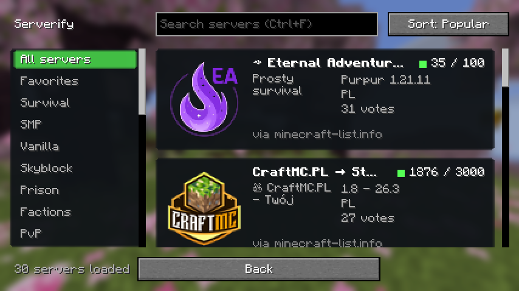
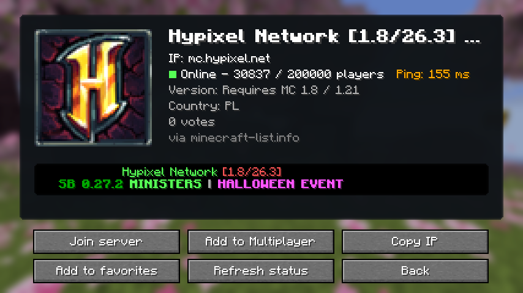
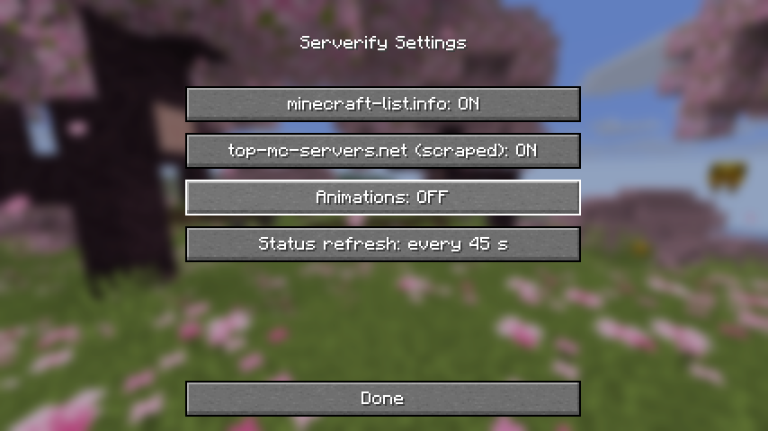

# Serverify

[](https://github.com/Louchatfroff/serverify/actions/workflows/build.yml)
[](https://github.com/Louchatfroff/serverify/releases/latest)
[](LICENSE)


A client-side [Fabric](https://fabricmc.net) mod that adds a fast, native **server browser** to Minecraft's Multiplayer screen. Search, filter, check live status and join, without leaving the game.



## Features

- **Browser:** large server cards with icon, description, tags, player count, version and country. Smooth scrolling, endless loading, hover animation and loading placeholders.
- **Categories and search:** 25 categories (Survival, Skyblock, Prison, PvP, Towny, Cobblemon and more), instant search and sorting by popularity, newest, players or name.
- **Live status:** the server page uses Minecraft's own server ping for real latency, player count, version and the live MOTD, and refreshes every 30 to 60 seconds.
- **Join or save:** connect immediately, or add the server to your Multiplayer list in one click.
- **Favorites:** a local list stored as JSON in `config/serverify/`.
- **Sources:** [minecraft-list.info](https://minecraft-list.info) loads first, then other sites. The same server never appears twice.
- **Settings:** enable or disable each source, animations and the refresh interval, through [Mod Menu](https://modrinth.com/mod/modmenu).
- **Accessible:** keyboard navigation (arrows, Enter, Ctrl+F), narration support, and translation keys for every string.

| Server page | Settings |
| --- | --- |
|  |  |

## Install

1. Install [Fabric Loader](https://fabricmc.net/use/installer/) for your Minecraft version.
2. Download [Fabric API](https://modrinth.com/mod/fabric-api) for the same version.
3. Download the Serverify jar for your version from the [latest release](https://github.com/Louchatfroff/serverify/releases/latest).
4. Put both jars in `.minecraft/mods`.
5. Start the game, open **Multiplayer** and press the **Serverify** button.

| Minecraft | Jar |
| --- | --- |
| 26.1, 26.1.1, 26.1.2 | `serverify-mc26.1-<version>.jar` |
| 26.2 | `serverify-mc26.2-<version>.jar` |
| 26.3 | `serverify-mc26.3-<version>.jar` |

Requires Java 25, which the official launcher installs for these versions. Mod Menu is optional.

## Build from source

You need JDK 25.

```bash
./gradlew build
```

The jar is written to `build/libs/`. Build for another Minecraft version by passing the values from [`.github/versions.json`](.github/versions.json):

```bash
./gradlew build -Pminecraft_version=26.3 -Pfabric_api_version=0.162.0+26.3 -Pcompat=show "-Pminecraft_range=>=26.3 <26.4"
```

Run the game with the mod, or run the scripted in-game test that saves screenshots to `build/run/clientGameTest/screenshots`:

```bash
./gradlew runClient
./gradlew runClientGameTest
```

## How it works

```
provider/   ServerSource per site, plus a registry that loads them in order and removes duplicates
network/    async HTTP with timeout and retry
favorites/  local JSON storage
config/     settings stored in config/serverify.json
client/     screens, widgets, icon cache and the Multiplayer integration (client-only code)
```

`src/compat/<name>` holds the few lines that differ between Minecraft versions. A new Minecraft release is built weekly by CI, which tells us when the game API moves.

### Adding a Minecraft version

Add an entry to [`.github/versions.json`](.github/versions.json) with the Minecraft version, the matching Fabric API version, the `compat` folder (`legacy` for 26.1, `show` for 26.2 and newer) and the version range. CI builds and releases it automatically.

## Releases

Pushing a tag such as `v0.2.0` builds a jar for every version in `versions.json` and publishes them to GitHub Releases.

## Notes

Server listings come from third-party sites. Some are read from public pages, so listings can change or stop working without notice. Serverify is not affiliated with Mojang, Microsoft or any listed server.

## License

[MIT](LICENSE)
